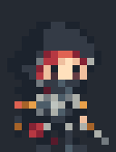
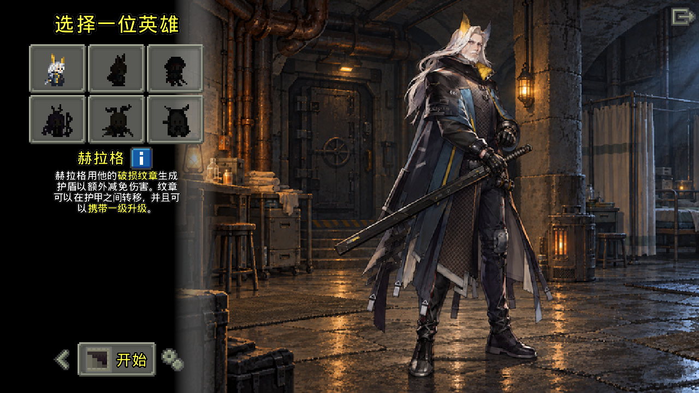
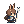
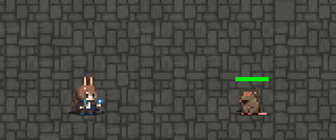
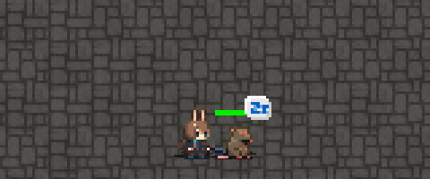
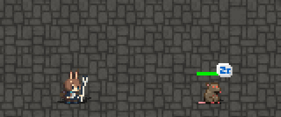
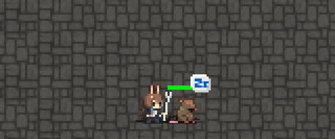
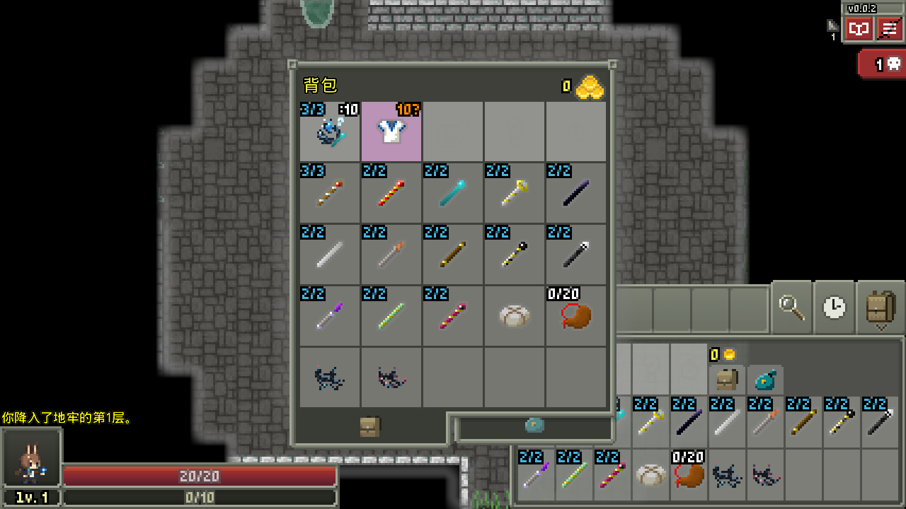
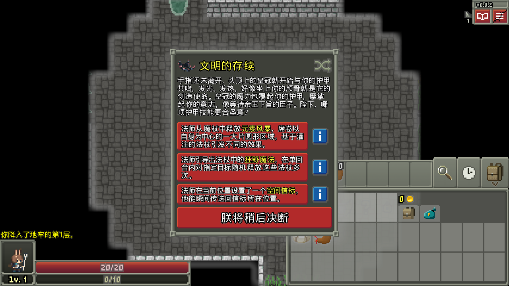
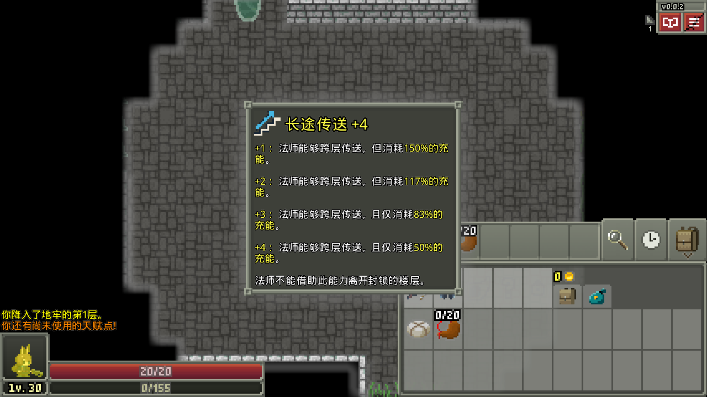

# Arknights Pixel Dungeon · 明日方舟像素地牢

**作者 / 维护者：holy1ow · 当前版本：0.0.3**

**当前发行：v0.0.3 · 阿米娅原版机制换皮封版**。已修正上一日期包仍显示 0.0.2 的版本标识；游戏内、Windows 包和 Git 标签统一为 0.0.3。阿米娅已冻结，本次没有改动美术和玩法。见 [版本说明](docs/RELEASE-0.0.3.md)。

基于 [Shattered Pixel Dungeon（破碎的像素地牢）4.0.2](https://github.com/00-Evan/shattered-pixel-dungeon/tree/v4.0.2) 开发的非官方同人项目；破碎的像素地牢又基于 [Pixel Dungeon（像素地牢）](https://github.com/watabou/pixel-dungeon)。感谢 Oleg Dolya（Watabou）、Evan Debenham 和所有上游贡献者。

**0.0.3 是当前开发快照，以角色贴图替换及必要的显示适配为主。** 角色选择界面只保留六位换皮角色，职业、战斗、成长、道具机制及职业解锁条件沿用破碎的像素地牢，没有加入角色专属技能或新机制。全角色美术尚未全部验收，本版本不代表美术最终完成。

## 下载与运行

[下载 Windows 游戏包（77.7 MB）](https://github.com/holy1ow/arknights-pixel-dungeon/releases/download/v0.0.3/01-Game-Windows.zip)。只需下载第一个附件 **01-Game-Windows.zip**，完整解压后运行 **Start-Game.cmd** 或 **Arknights Pixel Dungeon.exe**。Windows 10/11 x64，显卡需支持 OpenGL 2.0；内含 Java 17，无需另装。

发行包不附带存档。首次运行创建全新进度，默认仅解锁战士对应的 **赫拉格**，其他角色按原版条件解锁；新手引导及教程提示保留。存档目录独立于上游游戏：`%USERPROFILE%\AppData\Roaming\.holy1ow\Arknights Pixel Dungeon\`。测试存档、个人存档、制作候选稿和 trainer 均不随包发布。

## 角色对应与当前预览

以下为当前已实装待机动画，缩放仅用于展示。角色对应的是原版机制，名称不表示已经实现《明日方舟》中的技能。

| 当前角色 | 对应原职业 | 当前动画 |
| --- | --- | --- |
| 赫拉格 Hellagur | 战士 Warrior |  |
| 阿米娅 Amiya | 法师 Mage |  |
| 弑君者 Crownslayer | 盗贼 Rogue |  |
| 提丰 Typhon | 女猎手 Huntress |  |
| 锏 Degenbrecher | 决斗家 Duelist |  |
| 闪灵 Shining | 牧师 Cleric |  |



上图使用全新进度展示，只有赫拉格默认解锁；其他角色的暗色图标表示尚未解锁。

### 阿米娅封版内容

阿米娅 **v4 三形态完整动作已接入**：转职前术师手托蓝色术式；原版战斗法师使用持剑近卫外观；原版术士使用医疗外观。**医疗造型已确定为贴近身体的白色法杖，带蓝色杖端光。** 原认可稿的像素、动作与帧时长保持不变。

| 术师：原法师 | 近卫：原战斗法师 | 医疗：原术士 |
| --- | --- | --- |
|  |  |  |

已接入六组核心效果：`arts-projectile`、`arts-impact`、`sword-arc`、`sword-impact`、`staff-release`、`heal-return`。以下保留的是 **v0.0.2 发布工程实际 GameScene/OpenGL 渲染**的局部录制预览，使用隔离测试存档，不是离线特效叠图。

| 蓝色通用法术 | 近卫挥剑 |
| --- | --- |
|  |  |
| **白杖出手** | **原版实际恢复** |
|  |  |

蓝色弹道与命中仅对白名单内、非诅咒的通用魔弹法杖生效，并要求当前真实身份和显示外观都是阿米娅。火焰、冰霜、雷电及其他法杖保留原版弹道、命中和机制；白杖可显示局部出手提示。恢复光只在原版灵魂标记确实恢复生命时触发。**没有新增免费远程攻击、主动治疗、自由形态切换或专属技能，原版机制及其他角色保持；充能、灌注与状态显示采用本次封版确认稿。**

详细验证见 [0.0.2 记录](docs/RELEASE-0.0.2.md)，包含左右朝向、身体定位、镜像/分身、元素法杖及其他角色对照。Release 的 `runtime-previews.zip` 提供全部 13 组精简实机录制；完整测试帧仅在本地归档，不上传大量截图。旧版“未选型”说明保留在 v0.0.1 历史记录中，不代表当前状态。

本次继续接入已认可头像、装备、进阶物品、职业护甲和三枚护甲能力图标、充能灌注提示与灵魂标记、27 枚天赋最终混选图标、常用状态图标以及空间信标与传送表现。T26 采用 V4，其余按逐项选版记录；波涌余威、卷轴赋能、魔力强化保留原版图形，仅对符合条件的阿米娅蓝色染色，样稿 PNG 没有覆盖共享运行图集。原版护盾保持。

以下三图是 2026-10-20 封版工程回归时实际渲染的未改动截图（测试夹具提供装备与天赋点，不代表自然游玩进度）：







## 后续制作计划

阿米娅素材与机制现已冻结，等待新的明确任务。其他角色美术还会继续制作和替换；角色专属技能也计划在后续版本制作、更换。装备及其他游戏道具的替换美术素材正在制作中，尚未完成或接入的内容不计入本次发布。

当前仍处于共同开发阶段。待共同角色美术全部完成并验收后，再从验收后的共同美术基线拆分两条路线：

1. **原版机制换皮版**：保留原版职业、战斗、成长和道具机制，继续替换美术及必要展示内容。
2. **角色特色机制版**：共用角色美术，再开发角色专属技能和机制。

这份封版公开副本属于当前纯换皮方向的开发快照；特色机制尚未进入本轮，也没有提前创建特色机制开发分支。

## 源码与构建

仓库包含桌面版完整构建源码、运行资源、Gradle Wrapper、当前实装美术的可编辑源文件及必要说明。为减少下载量，不带 Android/iOS 工程、构建缓存或二进制发行包。为完整保留成果，正式素材、旧方案、未选素材和完整验证档案放在 Release 的归档附件中；玩家只需下载 Windows 包，源码仓库不重复塞入大型 ZIP。

安装 JDK 21，设置 `JAVA_HOME` 后运行：

```bat
gradlew.bat desktop:check desktop:verifyHeroSelection desktop:verifyPackagedOperators desktop:verifyOperatorCanvas desktop:verifyAmiyaEffects desktop:verifyAmiyaItems desktop:verifyAmiyaArmor desktop:verifyAmiyaIcons desktop:verifyAmiyaPortraits desktop:verifyAmiyaStatusTint --console=plain --max-workers=2 --no-daemon
Build-Desktop.cmd
Start-Game.cmd
```

首次构建会下载 Gradle、Maven 依赖和打包用 Temurin JDK 17，需联网。构建产物位于 `desktop/build/`。详见 [构建与验证说明](docs/RELEASE-0.0.2.md)、[美术编辑入口](art/README.md) 和 [接续说明](docs/HANDOFF.md)。

## 开源协议与署名

游戏代码采用 **GNU GPL v3 或后续版本（GPL-3.0-or-later）**，完整协议见 [LICENSE.txt](LICENSE.txt)。继承的版权声明和贡献者署名保留；本项目改编署名为 holy1ow。修改范围与日期见 [MODIFICATIONS.md](MODIFICATIONS.md)，第三方素材、依赖及 Java 运行时另见 [THIRD-PARTY-NOTICES.md](THIRD-PARTY-NOTICES.md) 与 [NOTICE.md](NOTICE.md)。软件按现状提供，不作担保。

分发修改版时须遵守 GPL，保留版权和许可声明、注明修改，并提供对应版本的完整可修改源码及构建脚本。此仓库的 `v0.0.3` 标签对应本次 Windows 发行；当前实装美术的可编辑文件也随源码提供。

本项目与鹰角网络、Hypergryph、Gryphline/Yostar 及 Pixel Dungeon、Shattered Pixel Dungeon 官方均无隶属或授权背书关系。《明日方舟》角色设计、名称及相关商标的权利归各自权利人所有；GPL 声明不授予这些第三方商标或角色 IP 的额外权利。本项目新增代码及由贡献者可授权的原创修改按 GPL-3.0-or-later 提供。
