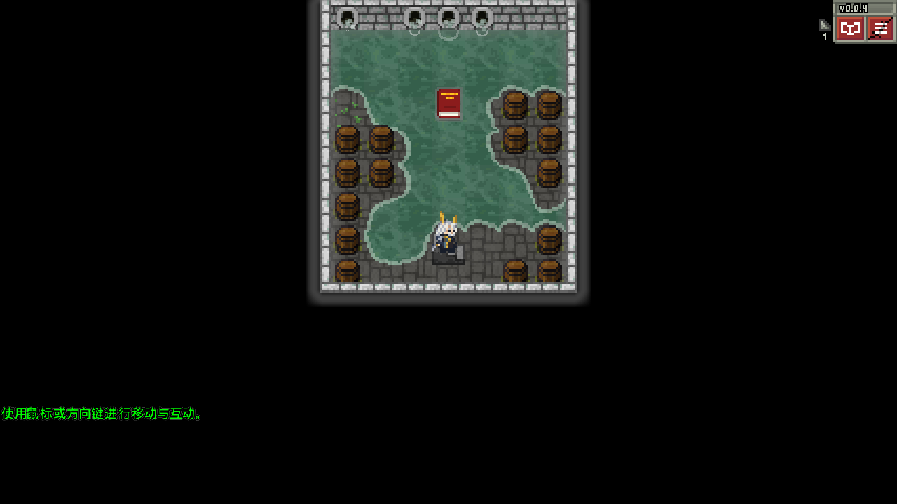

# v0.0.4 六角色联合验收

2026-10-23，基于独立公开工程的新构建执行。**21组桌面/窄屏回归最终通过**，并完成实际jpackage EXE的跨版本与新开局检查。全部使用包外隔离配置和进度，1280×720小窗；540×960是桌面OpenGL夹具，不是手机实测。

| 检查 | 结果 |
| --- | --- |
| Gradle check、两个JAR版本元数据、jpackage | 通过；HeroClassChecks 60504项检查 |
| 六角色选择与原解锁 | 中文宽/窄屏、英语宽屏通过；仅赫拉格初始解锁 |
| 六角色两转职及随机选择 | 12条职业路线＋随机阿米娅路线，预览/取消/确认/装备/磁盘重载/伪装/镜像/记录/结算头像通过 |
| 阿米娅完整检查点流程 | 桌面7条＋窄屏2条；转职、3种护甲能力、原状态、五区域、复活、护符结局、死亡分支 |
| 赫拉格完整检查点流程 | 桌面7条＋窄屏2条；原盾/充能、六种专属状态保存、进阶效果、原消耗、区域/结局/死亡 |
| 不屈/连斩显示 | 84张左右帧截图＋6张通用效果；8动作时间轴、7护甲行、脚底/点击/粒子/镜像边界通过 |
| 专属与原版隔离 | 天赋、装备、元素法杖、状态大小图、伪装/空英雄/对象复用、其他身份通过 |
| 头像与文案 | 宽/窄屏各9头像场景；8个紧凑进阶窗口；20条英语回退；原版确认/取消/无护甲条件 |
| 跨版本真实EXE | v0.0.3产生12份隔离测试档，v0.0.4继续六角色各两转职；2002项断言，退出后再次冷继续800项断言 |
| 连续攻击真实EXE | 8组身份/形态，96次实际输入攻击、8次法杖使用及原充能消耗、1→2→1上下楼、互斥效果及线程锁检查；1355项断言 |
| 全新开局真实EXE | 空目录、欢迎页、6角色、仅赫拉格解锁、原序章继续按钮、新手教程、1级基础形态与原起始装备；16项断言 |
| 素材与作用域 | 66份原生源导出像素一致；176项素材/30图集单格/617打包资源校验；105项非赫拉格记录保护；头像只改槽4/5 |

测试会提供关键奖励、装备、检查点楼层、静止敌人或楼梯位置，正式UI、战斗回调、保存和渲染仍由产品代码执行。外置EXE探针使用parent-first加载，生产类由实际包内JAR提供，没有替换游戏类。真实空进度开局流程不注入角色进度。没有对所有随机种子、所有道具组合、所有Boss自然游玩或移动设备作穷尽保证。

初次图标检查仍把赫拉格的共享天赋图标当作预期，更新测试断言后2086项通过。测试编译中重复的测试辅助方法已移除；首次开局探针最初在徽章加载前检查、遗漏原序章继续按钮，及一次加载旧探针的尝试，均保留失败/中止证据，修正夹具后通过。无需为这些夹具问题修改产品代码。

复现入口：`desktop:check`、`desktop:verifyHeroSelection`、`desktop:verifyPackagedOperators`、`desktop:verifyOperatorCanvas`、各`verifyAmiya*`任务，以及`verifyAmiyaLifecycle`、`verifyHellagurLifecycle`、`verifyHellagurEffects`、`verifyHellagurSubclasses`、`verifyCurrentPortraits`、`verifyCompactCopy`。传入`-PqaWidth=540 -PqaHeight=960`可运行支持宽高参数的窄屏检查。`scripts/verify_assets.py`检查源/运行资源与可选app-image。

完整本轮日志、原始截图、外部探针、失败记录及旧验证证据存于Release `04-Tests.zip` / `05-Tests-2.zip`；相同文件按SHA-256去重存储，附恢复脚本和路径索引。测试存档/私人数据不进入上传包；旧运行包原件本地保留，归档内记录其哈希。最终解压启动及公开下载、附件顺序、SHA-256核对记录在发行归档目录中，不等同于人工完整通关。
